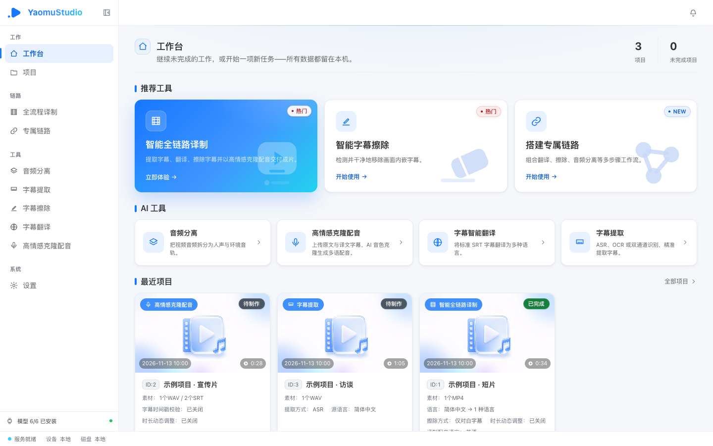

English | [简体中文](README.zh-CN.md)

<p align="center">
  
</p>

<h1 align="center">YaomuStudio</h1>

<p align="center">A local-first desktop client for media translation and dubbing</p>

<p align="center">
  
  
  
  
  
</p>

YaomuStudio runs media translation and dubbing on your own machine: ASR, translation, text-to-speech, voice cloning, subtitle erase, and audio separation, with OCR assist. There is no sign-in, and projects, subtitles, and source media stay local.

It is built for translating subtitles, dubbing in the original speaker's voice, removing burned-in subtitles, and continuing work on prepared projects in restricted-network environments.

<picture>
  <source media="(prefers-color-scheme: dark)" srcset="assets/readme/workbench-dark.png">
  
</picture>

<p align="center"><sub>Workbench · demo data</sub></p>

## Capabilities

| Capability | Status | Notes |
|---|---|---|
| ASR | `READY` | Extract subtitles from audio or video, with timestamps and language. |
| Translation | `READY` | Translate subtitles sentence by sentence; edit source and target side by side. |
| Text-to-speech | `PREVIEW` | Folded into the voice-clone entry; generate target-language dubbing per sentence. |
| Voice cloning | `PREVIEW` | Build a voice from reference audio and generate multilingual dubbing. |
| Subtitle erase | `PREVIEW` | Detect and remove burned-in subtitles. |
| Audio separation | `PREVIEW` | Split voice and ambience for mixing or dubbing. |
| OCR assist | `PREVIEW` | Read on-screen text for subtitle and erase workflows. |

> Status is relative to the Windows + WSL2 baseline; Linux is best-effort. macOS release builds are temporarily unavailable.

## Download

Installers are built by GitHub Actions on `v*` tags. Download them from the [official site](https://yaomustudio.yaomuai.com/). The current builds are unsigned.

| Platform | Installer | Notes |
|---|---|---|
| Windows x64 | `YaoMuStudio-0.1.0-beta.12-win-x64.exe` | NSIS. SmartScreen may warn. Model execution uses WSL2. |
| Linux x64 | `YaoMuStudio-0.1.0-beta.12-linux-x64.AppImage` | Preview; requires a GPU driver. Model execution is best-effort. |
| macOS | — | Release builds are temporarily excluded until macOS packaging is fixed and models are ready. |

**Requirements:** model execution on Windows needs a working WSL2 environment. Linux is best-effort. macOS release builds are temporarily unavailable. Windows builds are unsigned; SmartScreen may warn.

## Quick start

```text
1. Download the installer for your platform
2. On first launch, download the models you need from the onboarding page
3. Create a project and import video, audio, or subtitles
4. Run the pipeline, correct sentences, then export
```

## Local-first

- **Data stays on your machine**: projects, subtitles, source media, and model outputs are written to a local workspace and are not uploaded by default.
- **No sign-in**: there is no account system and no required cloud workspace. You can create a project right after installing.
- **Works offline**: models and media capabilities that are already prepared keep working without a network. Updates and model downloads are separate network actions.

## Architecture

The Electron main process owns the privileged boundary; Vue 3 renders the UI; the Go Core is the single authority for business state; the Python Runner only performs controlled execution; models are invoked through FlashCLI and media is processed by a pinned FFmpeg build.

<details>
<summary>Show process and data flow</summary>

```text
Electron Main / preload
  └─ Vue 3 renderer
       └─ Go Core (single authority for business state)
            ├─ SQLite (projects / tasks / installations)
            ├─ Python Runner (controlled execution adapter)
            │    ├─ FlashCLI (models)
            │    └─ FFmpeg / ffprobe (media)
            └─ local HTTP JSON + SSE
```

</details>

The renderer never talks to the Core, the filesystem, or arbitrary IPC directly. Every privileged operation goes through preload and a main-process allowlist.

## Status and limitations

| Area | Status | Notes |
|---|---|---|
| Control plane | `DONE` | Electron / Vue / Go Core / SQLite / Runner / FFmpeg wiring. |
| Real model bundles | `MISSING` | Real bundles for the six slots, signed manifests, and strict offline acceptance. |
| macOS build / model execution | `MISSING` | macOS release builds are temporarily excluded; Linux is best-effort. |
| Signing / notarization | `MISSING` | Current Windows and Linux builds are unsigned. |
| Install rollback | `MISSING` | Keeping the previous version and verifying rollback are still planned. |

> The README does not present unfinished capabilities as available. Release notes will track the actual status per version.

## Development

```bash
./scripts/setup-dev.sh
npm install
npm run typecheck
npm run build
npm run test:macos   # local macOS automation baseline
npm run test:e2e     # UI E2E with browser fixtures
```

Requires Node 22, Go 1.23+, and Python 3.11+. Desktop changes need to be verified in a real Electron run; a successful compile is not enough.

See [CONTRIBUTING.md](CONTRIBUTING.md) before submitting changes.

## License

Apache-2.0. Model weights and third-party dependencies have their own licenses. FFmpeg is distributed as a separate executable under its GPL/LGPL terms; the bundled Python runtime follows the PSF license.
