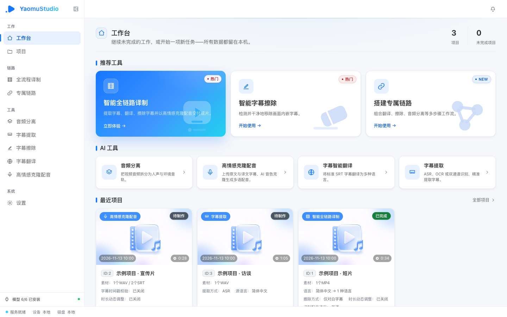

简体中文 | [English](README.md)

<p align="center">
  
</p>

<h1 align="center">YaomuStudio（曜幕）</h1>

<p align="center">本地优先的媒体翻译与配音桌面客户端</p>

<p align="center">
  
  
  
  
  
</p>

曜幕把媒体翻译与配音放在一台机器上完成：ASR、翻译、语音合成、声音克隆、字幕擦除、音频分离，外加 OCR 辅助。免登录，项目、字幕与素材留在本地。

它适合需要翻译字幕、保留原说话人音色做配音、擦除画面内嵌字幕，或在受限网络环境中继续处理已准备项目的场景。

<picture>
  <source media="(prefers-color-scheme: dark)" srcset="assets/readme/workbench-zh-dark.png">
  
</picture>

<p align="center"><sub>工作台 · 演示数据</sub></p>

## 能力

| 能力 | 状态 | 说明 |
|---|---|---|
| ASR 语音识别 | `READY` | 从音视频提取字幕，保留时间戳与语种。 |
| 翻译 | `READY` | 按句翻译字幕，原文/译文对照校正。 |
| 语音合成（TTS） | `PREVIEW` | 已合并到语音克隆入口；按句生成目标语言配音。 |
| 声音克隆 | `PREVIEW` | 从参考音频建立音色，生成多语种配音。 |
| 字幕擦除 | `PREVIEW` | 检测并移除画面内嵌字幕。 |
| 音频分离 | `PREVIEW` | 分离人声与环境声，供混音与配音使用。 |
| OCR 辅助 | `PREVIEW` | 识别画面文字，辅助字幕与擦除流程。 |

> 状态以 Windows + WSL2 基线为准；Linux 为 best-effort；macOS 发布构建暂时排除。

## 下载

安装包由 GitHub Actions 在 `v*` tag 上构建，前往[官网](https://yaomustudio.yaomuai.com/)下载。当前版本未签名。

| 平台 | 安装包 | 说明 |
|---|---|---|
| Windows x64 | `YaoMuStudio-0.1.0-beta.2-win-x64.exe` | NSIS；SmartScreen 可能提示。模型执行走 WSL2。 |
| Linux x64 | `YaoMuStudio-0.1.0-beta.2-linux-x64.AppImage` | preview；需要 GPU 驱动。模型执行 best-effort。 |
| macOS | — | 发布构建暂时排除；等 macOS 打包修复且模型就绪后再提供。 |

**前置条件**：Windows 的模型执行需要可用的 WSL2 环境；Linux 为 best-effort；macOS 发布构建暂时排除，等修复打包并确认模型就绪后再提供。Windows 安装包未签名，SmartScreen 可能提示。

## 快速开始

```text
1. 下载对应平台的安装包
2. 首次启动，在引导页下载所需模型
3. 新建项目，导入视频 / 音频 / 字幕
4. 运行流水线，逐句校正后导出
```

## 本地优先

- **数据留在本机**：项目、字幕、音视频与模型产物写入本地工作区，不默认上传。
- **免登录**：没有账号体系，不要求云端工作区；安装后即可创建项目。
- **离线可用**：已就绪的模型与媒体能力在断网时照常运行；更新与模型下载是独立的联网行为。

## 架构

Electron 主进程持有特权边界；Vue 3 负责界面；Go Core 是唯一业务状态权威；Python Runner 只做受控执行适配；模型通过 FlashCLI 调用，媒体处理走固定版本 FFmpeg。

<details>
<summary>展开进程与数据流</summary>

```text
Electron Main / preload
  └─ Vue 3 renderer
       └─ Go Core（唯一业务状态权威）
            ├─ SQLite（项目 / 任务 / 安装记录）
            ├─ Python Runner（受控执行适配）
            │    ├─ FlashCLI（模型）
            │    └─ FFmpeg / ffprobe（媒体）
            └─ 本地 HTTP JSON + SSE
```

</details>

Renderer 不直接访问 Core、文件系统或任意 IPC；所有特权操作经 preload 与主进程白名单代理。

## 状态与限制

| 范围 | 状态 | 说明 |
|---|---|---|
| 控制面 | `DONE` | Electron / Vue / Go Core / SQLite / Runner / FFmpeg 链路。 |
| 真实模型 bundle | `MISSING` | 六槽位真实 bundle、签名清单与严格离线验收。 |
| macOS 构建 / 模型执行 | `MISSING` | macOS 发布构建暂时排除；Linux 为 best-effort。 |
| 签名 / 公证 | `MISSING` | 当前 Windows / Linux 安装包未签名。 |
| 安装失败回滚 | `MISSING` | 保留旧版本与回滚验证仍在计划中。 |

> README 不把未完成的能力写成已可用；发布说明会按版本更新实际状态。

## 开发

```bash
./scripts/setup-dev.sh
npm install
npm run typecheck
npm run build
npm run test:macos   # macOS 本地自动化基线
npm run test:e2e     # UI E2E（浏览器夹具）
```

要求 Node 22、Go 1.23+、Python 3.11+。桌面端改动需要在真实 Electron 中验证，不以编译通过代替。

提交前请阅读 [CONTRIBUTING.md](CONTRIBUTING.md)。

## 许可

Apache-2.0。模型权重与第三方依赖各有独立许可；FFmpeg 以独立可执行文件分发，遵循其 GPL/LGPL 许可；Python 运行时遵循 PSF 许可。
